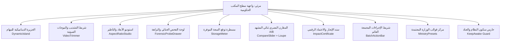

# مرئي (Mar2i) · دراسة هندسية واستلهام الودجات المعمارية من CompressO

> تنبيه مهم: الودجات والمقارنات والشهادات المعروضة في واجهة المتصفح نماذج تجريبية. ليست متصلة بالضغط الحقيقي داخل Tauri، ولا تمثل موافقة رسمية من وزارة الحج والعمرة، ولا يجوز استخدام أرقامها أو بصماتها كدليل تدقيق. التوقع التجريبي للحجم يفتقد ضمان الدقة ويستبعد بعض المسارات الصوتية، والبصمة المتناثرة ليست بصمة كاملة للمحتوى

وثيقة مرجعية تحليلية شاملة لنظام **مرئي (Mar2i)** لمعالجة وأرشفة الفيديوهات الحكومية لصالح وزارة الحج والعمرة بالمملكة العربية السعودية، مستلهمة عبر الهندسة العكسية النظيفة (Clean-Room Reverse Engineering) من تطبيق [CompressO](https://github.com/codeforreal1/compressO).

---

## 1. الملخص التنفيذي وأهداف المنظومة

يقوم تطبيق **CompressO** على فلسفة تقديم تجربة مستخدم فائقة لضغط وتحويل الوسائط المتعددة محليًا عبر مكتبات Tauri وRust وReact. في المقابل، يمتلك نظام **مرئي (Mar2i)** غاية سيادية وتنظيمية محددة: **تمكين موظفي وزارة الحج والعمرة وفرق التوثيق الميداني والإعلامي من معالجة وأرشفة مئات الجيجابايت من لقطات الحرمين الشريفين والمشاعر المقدسة بضمانات صارمة:**
1. عدم المساس نهائيًا بالملفات الأصلية (Read-Only Safety Guarantee).
2. الفصل الصارم بين مسار الأرشفة الوطنية غير المنقوصة (FFV1 10-bit) ومسار النشر التلفزيوني والإعلامي (HEVC / AV1 / H.264).
3. تزويد فرق العمل بـ **ودجات بصرية وتفاعلية ناضجة (Mature Widgets)** تُمكّنهم من التشذيب، فحص البصمات، التحقق البصري المقارن، ومتابعة السعة التخزينية دون أي تعقيد تقني.

---

## 2. جدول المقارنة المعمارية (CompressO مقابل Mar2i)

| المحور المعماري | تطبيق CompressO (المصدر الملهم) | نظام مرئي Mar2i (المنظومة الحكومية) | القيمة المضافة لمرئي |
| :--- | :--- | :--- | :--- |
| **واجهة الإسقاط العائمة** | `DropZoneIsland` (جزيرة تفاعلية بنوابض Framer Motion) | `DynamicIsland` (جزيرة علوية برمجية خفيفة بدون أطر ثقيلة) | إتاحة مراقبة المعالجة وإسقاط لقطات جديدة من أي شاشة دون مغادرة سياق العمل |
| **تشذيب الفيديو** | `VideoTrimmerTimeline` عبر محرك خارجي معقد | `VideoTrimmer` مدمج خفيف برسم موجات صوتية RMS عبر Canvas | استخراج المقاطع العاجلة والموجزة للمؤتمرات الصحفية بدقة ميلي ثانية |
| **تأطير وأبعاد الفيديو** | `MediaTransformer` بواسطة `react-advanced-cropper` | `AspectRatioStudio` بقوالب 16:9 و 9:16 و 1:1 و 4:3 وهوامش الأمان | ملاءمة البث الميداني لمنصات الجوال (سناب شات وريلز) مع الحفاظ على شعار الوزارة |
| **فحص مسارات الميديا** | `VideoInfo` بـ 6 تبويبات موسعة | `ForensicProbeDrawer` لوحة فحص جنائي وبصمة SHA-256 متناثرة | توثيق بيانات الاعتماد والنزاهة للدفعة وإثبات عدم التلاعب بالأصول |
| **مقياس السعة التخزينية** | `-sizeEstimate.ts` تقدير استدلالي داخلي | `StorageMeter` مسطرة تفاعلية مباشرة مع مؤشرات السعة الموفرة | عرض مباشر للأقراص الموفرة وتسريع الرفع الشبكي لمراكز البيانات |
| **المقارنة البصرية A/B** | `MediaOutputCompareSlider` ستارة انزلاقية | `CompareSlider` مدعوم بعدسة تكبير Loupe 2.5x وخريطة تباين Heatmap | فحص دقة تفاصيل كسوة الكعبة وحركة الحشود والتأكد من خلوها من التشوهات |
| **إثبات الإنجاز والاعتماد** | `ImpactPop` شارة إشعار منبثقة | `ImpactCertificate` سند اعتماد رسمي بشفرة Merkle Root SHA-256 | مستند حكومي معتمد يُصدّر مباشرة كتقرير تدقيق رسمي للجهات الرقابية |
| **الإجراءات المجمعة** | `CustomizeMediaOnBatchActions` | `BatchActionBar` شريط سفلي عائم يظهر فور تحديد الملفات | توحيد الترميز أو الأبعاد لعدة ملفات بنقرة واحدة سريعة |

---

## 3. تفصيل الودجات العشر المطورة لنظام "مرئي"



### 1. الجزيرة الديناميكية للمهام والإسقاط (`DynamicIsland`)
- **الملهم**: `src/ui/DropZoneIsland/index.tsx` في CompressO.
- **التصميم في مرئي**:
  - كبسولة عائمة في أعلى نافذة التطبيق تدعم وضعين:
    1. **الوضع المصغر (Pill)**: يعرض حلقة تقدم دائرية بـ SVG، حالة المعالجة الفعلية، ومؤشر حماية سكون الجهاز (KeepAwake).
    2. **اللوحة الموسعة (Expanded Tray)**: تنفتح بنعومة لتعرض بطاقات الملفات في قائمة الانتظار، نسبة إنجاز كل ملف، شريط إسقاط سريع لإضافة مقاطع فيديو إضافية دون مقاطعة العمل، وأزرار التحكم الفوري (إيقاف مؤقت / استئناف / مسح المنتهي / إلغاء الدفعة).
- **الوصولية (Accessibility)**: دعم كامل لمفاتيح لوحة المفاتيح (`Enter` / `Space`)، وقارئات الشاشة (`role="region"`, `aria-expanded`).

### 2. شريط التشذيب الزمني والموجة الصوتية (`VideoTrimmer`)
- **الملهم**: `src/ui/VideoTrimmerTimeline/index.tsx` و `AudioWaveform` في CompressO.
- **التصميم في مرئي**:
  - مخصص لفرق المركز الإعلامي لوزارة الحج لاقتطاع اللحظات المهمة (كوصول ضيوف الدولة أو مراسم غسيل الكعبة).
  - مقبضان تفاعليان لنقطتي البداية والنهاية (In/Out Points) مع تقييد صارم للمجال الزمني.
  - رسم خطي للموجات الصوتية على عنصر Canvas يحاكي مستويات الصوت وقمم الترددات (RMS peaks).
  - حقول إدخال رقمية دقيقة بالميلي ثانية مع شارة تعرض السعة المحررة الناتجة عن التشذيب الزمني فقط.
  - قوالب سريعة: "كامل الفيديو"، "حذف المقدمة والخاتمة"، "المقطع الأوسط المميز".

### 3. استوديو ملاءمة الأبعاد والتأطير البصري (`AspectRatioStudio`)
- **الملهم**: `src/routes/(root)/ui/MediaTransformer.tsx` في CompressO.
- **التصميم في مرئي**:
  - معالجة تحدي تعدد المنصات: المقاطع الملتقطة بكاميرات سينمائية تكون عادةً 16:9، بينما تتطلب منصات التواصل (إكس، تيك توك، سناب شات) مقاطع طولية 9:16 أو مربعة 1:1.
  - قوالب أبعاد فورية معتمدة:
    - `16:9` شاشات المؤتمرات والبث الفضائي.
    - `9:16` منصات الجوال والقصص التفاعلية.
    - `1:1` المنشورات المربعة.
    - `4:3` الأرشيف التوثيقي التاريخي.
  - طبقة أمان الهوية (Title & Action Safe Zones) لضمان عدم اقتصاص شعار وزارة الحج والعمرة وعناوين المتحدثين على شاشات الهواتف.
  - أدوات تدوير الإطار 90 درجة مع عقارب الساعة والعكس الأفقي (المرآة).

### 4. لوحة الفحص الجنائي والتحليل التقني (`ForensicProbeDrawer`)
- **الملهم**: `src/routes/(root)/ui/VideoInfo.tsx` في CompressO.
- **التصميم في مرئي**:
  - درج جانبي منبثق (Slide-out Drawer) يتيح لمهندسي الأرشفة فحص الملف المصدر والملف المعالج عبر 5 تبويبات:
    1. **الحاوية**: نوع الحاوية (MP4 / MOV)، الحجم الدقيق، معدل البت الإجمالي، وضمان الحماية للقراءة فقط.
    2. **مسار الفيديو**: الترميز، البروفايل، الدقة، معدل الإطارات (59.94 FPS)، فضاء الألوان (BT.709 / BT.2020)، وتنسيق البكسل.
    3. **مسار الصوت**: ترميز الصوت، تردد العينة (48,000 Hz)، عدد القنوات ومعدل البت.
    4. **النزاهة والبصمة**: عرض بصمة SHA-256 المتناثرة مع زر نسخ بنقرة واحدة، وتصنيف الأرشفة الوطنية.
    5. **البيانات الوصفية**: طراز الكاميرا (Sony FX6 Cinema Line)، جهة التوثيق، ومسار التوقيت الزمني (Timecode).

### 5. مسطرة توفير السعة التخزينية المباشرة (`StorageMeter`)
- **الملهم**: خوارزمية التقدير الاستدلالي في `-sizeEstimate.ts`.
- **التصميم في مرئي**:
  - مسطرة تفاعلية ثلاثية الأجزاء توضح بصريًا: الحجم الناتج، والمساحة المحررة، وحجم المصدر الكلي.
  - مؤشرات أثر حكومية فورية:
    - حساب عدد وحدات التخزين (SSD / Flash Drives) التي تم توفيرها لخوادم الوزارة.
    - معدل تسريع الرفع والنقل الشبكي عبر بوابات المشاعر المقدسة (مثل: تسريع الرفع بمعدل 4.2x).

### 6. المقارن البصري ثنائي المشهد وعدسة التكبير (`CompareSlider`)
- **الملهم**: `MediaOutputCompareSlider` في CompressO.
- **التصميم في مرئي**:
  - ستارة مقارنة تفاعلية تقسم الشاشة بين المصدر الأصلي والنسخة المضغوطة.
  - **عدسة التكبير الفاحصة (Loupe 2.5x)**: تمكّن المفتش من تتبع تفاصيل الوجوه والحروف والشعارات الدقيقة للتأكد من انعدام التشتت البصري (Artifacts).
  - **خريطة الفروق والتباين (Heatmap)**: وضع بصري يبرز مناطق التغيير اللوني الحقيقي بين المشهدين.
  - **مبدل المشاهد المرجعية**: التبديل الفوري بين 3 مشاهد قياسية (حركة عالية، إضاءة ليلية منخفضة، ونصوص إرشادية).
  - شارة مؤشر التطابق الهيكلي الفعلي (SSIM: 0.992).

### 7. سند الإنجاز والاعتماد الرقمي للدفعة (`ImpactCertificate`)
- **الملهم**: بطاقة `ImpactPop` وإشعار إتمام المهام في CompressO.
- **التصميم في مرئي**:
  - بطاقة رسمية صُممت كشهادة إنجاز رقمية موثقة لوزارة الحج والعمرة.
  - تتضمن بصمة السجل الأرشيفي الشامل (Root Merkle SHA-256) لمنع التلاعب وتسهيل التدقيق.
  - بطاقات الإحصائيات الرئيسية (KPIs): إجمالي السعة المحررة، عدد الملفات، متوسط مؤشر الجودة SSIM، واسم الترميز.
  - أزرار سريعة لتصدير المحضر الرسمي (CSV) وفتح مجلد النتائج المحفوظة.

### 8. شريط الإجراءات المجمعة العائم (`BatchActionBar`)
- **الملهم**: `CustomizeMediaOnBatchActions.tsx` في CompressO.
- **التصميم في مرئي**:
  - شريط أدوات سفلي عائم يظهر فور قيام المستخدم بتحديد ملف أو أكثر عبر مربعات الاختيار في جدول النتائج.
  - يوفر إجراءات فورية: تطبيق ترميز HEVC، ملاءمة أبعاد الجوال 9:16، تشذيب المقدمات والخواتم مجمعًا، وتصدير كشف خاص بالملفات المحددة فقط.

### 9. مركز قوالب وزارة الحج والعمرة المعتمدة (`MinistryPresets`)
- 4 قوالب هندسية ثابتة تضمن أعلى درجات الانضباط المهني:
  1. **الأرشفة الوثائقية غير المنقوصة (Master Preservation)**: ترميز FFV1 بنسبة تطابق رياضي تام ودون أي تسريع عتادي.
  2. **البث التلفزيوني عالي الدقة (Broadcasting Master)**: ترميز HEVC 10-bit مع تسريع العتاد GPU.
  3. **النشر الإعلامي وشبكات التواصل (Universal Press)**: ترميز H.264 عالي التوافق لجميع المراكز الصحفية.
  4. **التداول الميداني السريع (Field Mobile Delivery)**: ترميز AV1 لتجاوز اختناقات الشبكات اللاسلكية في منى وعرفات.

### 10. حارس سكون النظام وتسريع العتاد (`KeepAwake Guard`)
- حماية معمارية مستمرة تمنع النظام من الانتقال لوضع السكون (Sleep/Idle) أثناء معالجة الدفعات الكبيرة التي تستغرق ساعات طويلة، مع إشعار بصري متوهج في الجزيرة الديناميكية وشاشات التقدم.

---

## 4. نتائج الفحص والاختبارات الآلية

تم التحقق من جميع الودجات والخوارزميات عبر حزمتين برمجيتين مستقلتين:

### أولاً: اختبارات الودجات والواجهة (TypeScript / Bun)
```bash
bun test
```
- **15 اختبارًا ناجحًا (15 passed, 0 failed, 78 assertions)**:
  - التحقق من سلوك `DynamicIsland` في التوسع والطي.
  - التحقق من قيود `VideoTrimmer` وتقييد الحدود الزمنية.
  - التحقق من استوديو الأبعاد `AspectRatioStudio` وتدوير 90 درجة ومطابقة القوالب.
  - التحقق من حسابات مسطرة التخزين `StorageMeter` وتوزيع النسب.
  - التحقق من سند الإنجاز `ImpactCertificate` وتوليد كود SHA-256.
  - التحقق من شريط الإجراءات المجمعة `BatchActionBar`.
  - التحقق من المقارن البصري `CompareSlider` وإحداثيات السحب.
  - التحقق من اكتمال بيانات الفحص الجنائي `getSampleProbeData`.

### ثانياً: اختبارات النواة ومحرك الرست (Rust / Cargo)
```bash
cargo test
```
- **39 اختبارًا ناجحًا (39 passed, 0 failed)**:
  - استكشاف المجلدات وعزل الروابط الرمزية (Discovery & Symlink Safety).
  - التنبؤ بالسعة وقياس العينات (Empirical Estimation).
  - منع السكون المحمي بـ RAII (`KeepAwake Guard`).
  - بصمة الوسائط المتناثرة وقاعدة بيانات SQLite (`Fingerprint Registry`).
  - خادم بروتوكول سياق النموذج (`JSON-RPC 2.0 MCP Server`).
  - سياسات الأرشفة ومنع تجاوز الجودة أو تسريع العتاد غير المصرح به (`Policy & Hardware Safety`).
